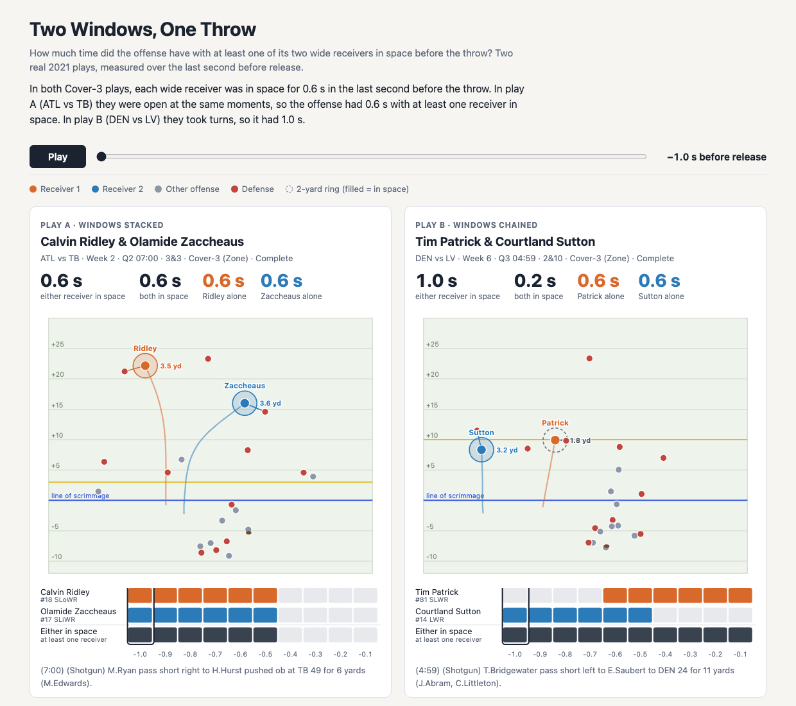

# Two Windows, One Throw

**[Live demo](https://shubhzam.github.io/nyuxnfl/)** · **[Notebook](two_windows_one_throw.ipynb)** · NFL Big Data Bowl, NYU Edition

In two Cover-3 plays, all four wide receivers were open for exactly 0.6 seconds in the last second before the throw, yet one quarterback had only 0.6 s with someone to throw to and the other had the full 1.0 s. The difference is timing: Ridley and Zaccheaus (ATL vs TB) got open at the same moments, so their windows stacked, while Patrick and Sutton (DEN vs LV) took turns, so their windows chained into one unbroken second. We call this **time with receiver space**: the part of the final second (10 tracking frames) in which at least one of two wide receivers had the nearest defender 2 or more yards away. We measured it on 1,788 plays from the 2021 tracking data (Weeks 1–8), and the gap holds at a stricter 2.5 yards (0.4 s vs 0.8 s). When both receivers got some space but neither was open the whole time, their windows chained on half the plays (+0.19 s on average), so offensive coaches can use it to check whether a route combination spreads its open moments across the drop or bunches them together. *Limitation:* it measures distance only (not passing lanes, leverage, pressure, or the quarterback's read), and in both featured plays the ball went to a tight end.

**Run it:** `pip install pandas numpy jupyter`, then run `two_windows_one_throw.ipynb` top to bottom. It downloads the [official data](https://github.com/ThompsonJamesBliss/nfl-big-data-bowl-regional-event-data) (about 870 MB, first run only), runs the metric sanity checks, and writes `index.html` (D3 v7).
